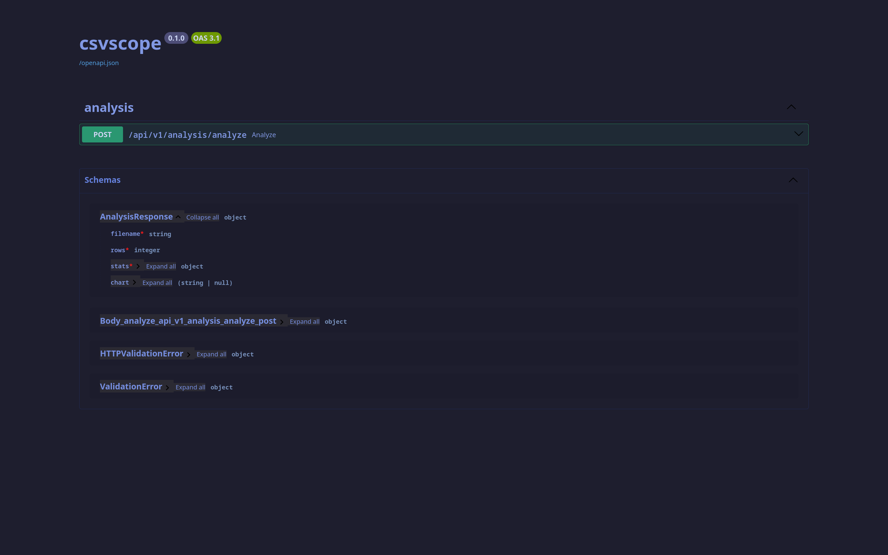
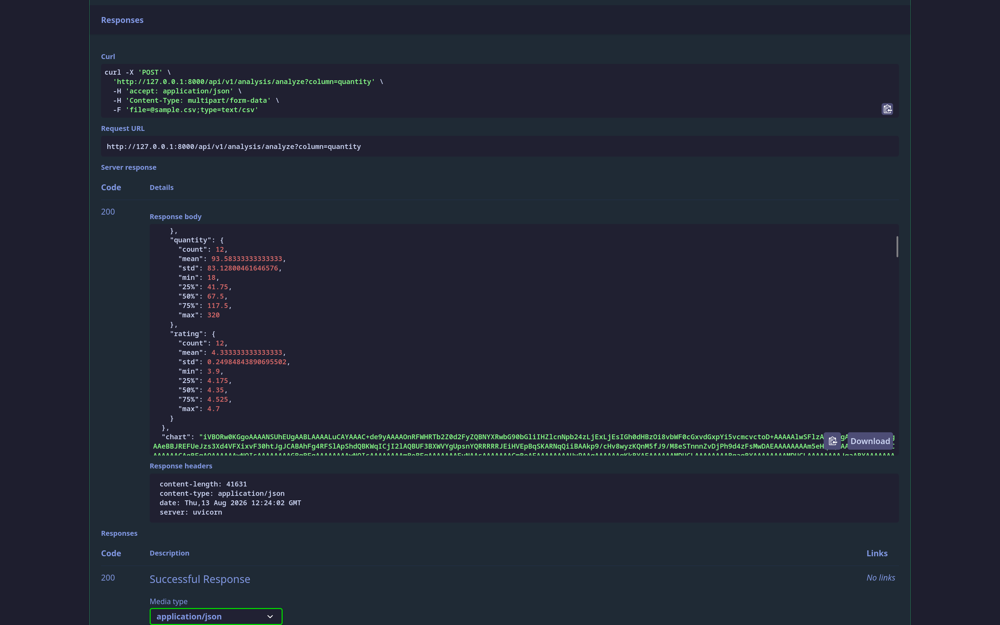
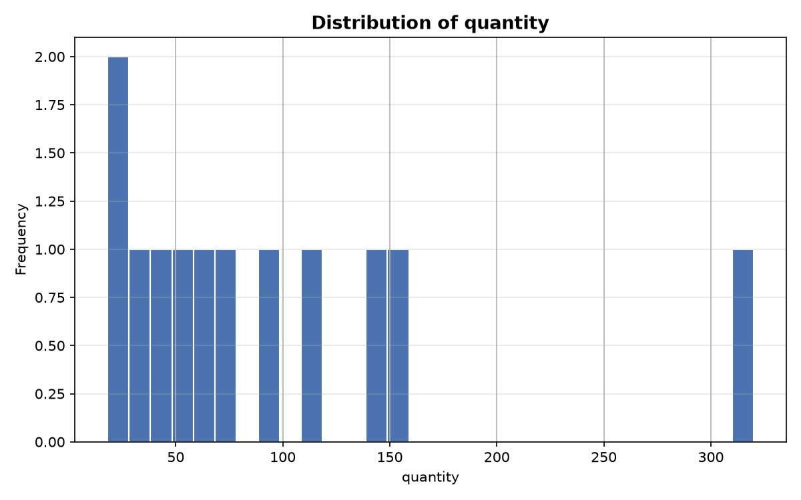

# csvscope

[](https://github.com/maniesh-lab/csvscope/actions/workflows/ci.yml)

A FastAPI API: upload a CSV and get back summary statistics for every number
column plus a histogram chart, all in one JSON response. Empty or broken files
get a clear `400` error instead of a crash.

The code is split into routers, services and models, so the API layer, the
pandas analysis and the matplotlib charts each live in their own place.

---

## Features

- Upload any CSV and get instant summary statistics (count, mean, std, min, max, quartiles) for every numeric column
- Auto-generated histogram chart, returned as base64 — no separate download step
- Chart column is selectable via a query parameter, defaulting to the first numeric column
- Handles missing/invalid data gracefully instead of crashing — empty files and malformed CSVs get a clear `400` error, and files that aren't UTF-8 are read as latin-1 (common from older Excel exports)
- File type validation with clear error messages
- Interactive, self-documenting API via Swagger UI
- Tested with `pytest` — 10 tests covering valid files and every error case

---

## Project Structure

```
csvscope/
│
├── routers/
│   ├── __init__.py
│   └── analysis.py            # POST /api/v1/analysis/analyze
│
├── services/
│   ├── __init__.py
│   ├── analyzer.py            # CSV parsing + summary stats (pandas)
│   └── chart_builder.py       # chart generation + base64 encoding (matplotlib)
│
├── models/
│   ├── __init__.py
│   └── response.py            # Pydantic response schema
│
├── core/
│   ├── __init__.py
│   └── exceptions.py          # custom API exceptions
│
├── utils/
│   ├── __init__.py
│   └── validators.py          # file type validation
│
├── tests/
│   ├── __init__.py
│   ├── sample.csv
│   └── test_analysis.py
│
├── screenshots/
│   ├── generated-chart.png
│   ├── sample-response.png
│   └── swagger-docs.png
│
├── .github/workflows/ci.yml   # lint + tests on every push
├── .gitignore
├── LICENSE
├── main.py
├── requirements.txt
├── requirements-test.txt      # + pytest, httpx and ruff for tests and lint
├── ruff.toml                  # lint rules
└── README.md
```

---

## How to Run

**1. Clone the repo**

```bash
git clone https://github.com/maniesh-lab/csvscope
cd csvscope
```

**2. Create and activate a virtual environment**

```bash
python -m venv venv
source venv/bin/activate
```

**3. Install dependencies**

```bash
pip install -r requirements.txt
```

**4. Start the server**

```bash
uvicorn main:app --reload
```

**5. Try it out**

Visit `http://127.0.0.1:8000/docs` and upload a CSV directly in the browser.

---

## API Docs



---

## Example Request

```bash
curl -X POST "http://127.0.0.1:8000/api/v1/analysis/analyze?column=quantity" \
  -H "accept: application/json" \
  -H "Content-Type: multipart/form-data" \
  -F "file=@your_file.csv;type=text/csv"
```

## Example Response

Shortened: the real response has stats for every number column (here `price`,
`quantity` and `rating`), not just `price`.

```json
{
  "filename": "sample.csv",
  "rows": 12,
  "stats": {
    "price": {
      "count": 12,
      "mean": 76.66,
      "std": 70.66,
      "min": 9.99,
      "25%": 33.74,
      "50%": 47.49,
      "75%": 99.99,
      "max": 249.99
    }
  },
  "chart": "iVBORw0KGgoAAAANSUhEUgA...",
  "message": null
}
```





---

## Tech Stack

| Tool | Purpose |
|---|---|
| `fastapi` | API framework |
| `uvicorn` | Runs the server |
| `python-multipart` | Lets FastAPI receive file uploads |
| `pandas` | CSV parsing and statistics |
| `matplotlib` | Chart generation |
| `pydantic` | Response validation and schema |
| `pytest` | Testing |
| `ruff` | Lint check, run with the tests by GitHub Actions on every push |

---

## Use Case

Built for small businesses and analysts who need quick statistical insights from
raw CSV data without opening Excel or writing custom analysis scripts — upload a
file, get numbers and a chart back in seconds.

---

## Notes

- Chart column can be specified via `?column=column_name` in the request; defaults to the first numeric column if omitted
- Non-CSV files are rejected with a `400` error (the `.csv` check ignores upper/lower case)
- If the requested column doesn't exist or isn't numeric, the stats still come back with `chart: null` and a `message` explaining why
- All processing happens in-memory — no files are written to disk

---

## Known Limitations

- Files that aren't UTF-8 are read as latin-1. That's fine for real latin-1 files, but files in other encodings (like UTF-16 or Shift-JIS) aren't rejected: they still come back `200`, with garbled column names

---

## Running Tests

```bash
pip install -r requirements-test.txt
pytest
ruff check .
```

GitHub Actions runs the same tests and lint check on Python 3.10–3.13 for every push.

---

## Author

**Manish Pandeya** · [github.com/maniesh-lab](https://github.com/maniesh-lab)